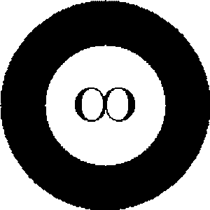

|Doc| |Licence|

|Logo|

NonlinearRegression
=============================
``NonlinearRegression`` is a small suite of tools to perform nonlinear regression, `scikitlearn` style.
It uses linear regression and data transformation to perform unweighted nonlinear regression
and implements a version of function spaces as Hilbert spaces to do weighted nonlinear regression.

Also, has a simple class to cross validate time series when treated as a regression problem.

Dependencies
=============================

    - `NumPy <http://www.numpy.org/>`_,
    - `scipy <https://www.scipy.org/>`_,
    - `matplotlib <https://matplotlib.org/>`_,
    - `scikit-learn <https://scikit-learn.org/stable/>`_,
    - `pandas <https://pandas.pydata.org/>`_,

Download
=============================
`NonlinearRegression` can be obtained from `https://github.com/mghasemi/nonlinear-regression <https://github.com/mghasemi/nonlinear-regression>`_.

Installation
=============================
To install `NonlinearRegression`, run the following in terminal::

    sudo python setup.py install

Documentation
=============================
The documentation is produced by `Sphinx <http://www.sphinx-doc.org/en/stable/>`_ and is intended to cover code usage
as well as a bit of theory to explain each method briefly.
For more details refer to the documentation at `nonlinear-regression.rtfd.io/ <http://nonlinear-regression.rtfd.io/>`_.

Changes in v0.3 (behavior-breaking, read before upgrading)
=============================
Bug fixes found by a 2026-10-26 validation pass (`tests/test_fixes_20261026.py`):

- **``HilbertRegressor.score`` now returns $R^2$** (scikit-learn convention: higher is better).
  The previous weighted mean square error is still available as ``mse``. Code that relied on
  ``score`` returning an error magnitude must be updated.
- **Confidence bands are now exact**: the old closed form was only valid for one-predictor
  linear regression and, as written, produced bands $\sim$8x too narrow with hard-coded
  degrees of freedom $n-2$. Bands are now
  $t_{1-\alpha/2,\,n-k}\,s\,\sqrt{b(x)^\top(B^\top W B)^{-1}b(x)}$ with the true basis size $k$;
  they are only produced when a discrete measure is used and $n > k$.
- **Ill-conditioned bases no longer corrupt fits**: above a Gram condition threshold
  (``GRAM_COND_LIMIT = 1e10``, e.g. monomial degrees $\gtrsim 7$ on $[0,1]$) the orthogonal basis
  is now built by weighted QR of basis evaluations instead of determinant ratios — previously
  such fits silently returned values off by orders of magnitude (or NaN). A linearly dependent
  basis raises ``Error`` instead.
- **Near-colliding abscissas are no longer merged**: the data-function spike kernel used an
  absolute window of $10^{-4}$ in normalized units, which collapsed distinct observations closer
  than that (e.g. hourly timestamps over a multi-year span). Matching is now exact up to float
  round-off only.
- **``Time2Interval`` preserves sub-day resolution** (previously ``.days`` truncated intraday
  timestamps onto whole days) and raises ``ValueError`` for an empty time span.

License
=============================
This code is distributed under `MIT license <https://en.wikipedia.org/wiki/MIT_License>`_:

MIT License
-----------------------------

    Copyright (c) 2020 Mehdi Ghasemi

    Permission is hereby granted, free of charge, to any person obtaining a copy
    of this software and associated documentation files (the "Software"), to deal
    in the Software without restriction, including without limitation the rights
    to use, copy, modify, merge, publish, distribute, sublicense, and/or sell
    copies of the Software, and to permit persons to whom the Software is
    furnished to do so, subject to the following conditions:

    The above copyright notice and this permission notice shall be included in all
    copies or substantial portions of the Software.

    THE SOFTWARE IS PROVIDED "AS IS", WITHOUT WARRANTY OF ANY KIND, EXPRESS OR
    IMPLIED, INCLUDING BUT NOT LIMITED TO THE WARRANTIES OF MERCHANTABILITY,
    FITNESS FOR A PARTICULAR PURPOSE AND NONINFRINGEMENT. IN NO EVENT SHALL THE
    AUTHORS OR COPYRIGHT HOLDERS BE LIABLE FOR ANY CLAIM, DAMAGES OR OTHER
    LIABILITY, WHETHER IN AN ACTION OF CONTRACT, TORT OR OTHERWISE, ARISING FROM,
    OUT OF OR IN CONNECTION WITH THE SOFTWARE OR THE USE OR OTHER DEALINGS IN THE
    SOFTWARE.

.. |Doc| image:: https://readthedocs.org/projects/nonlinearregression/badge/?version=latest
    :target: https://nonlinearregression.readthedocs.io/en/latest/
    :alt: Documentation Status
.. |Licence| image:: https://img.shields.io/badge/license-MIT-blue.svg
   :target: https://github.com/mghasemi/sksurrogate/blob/master/License.txt
